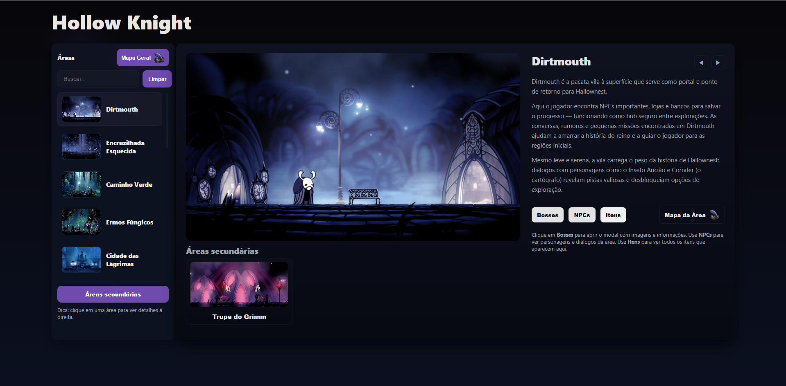
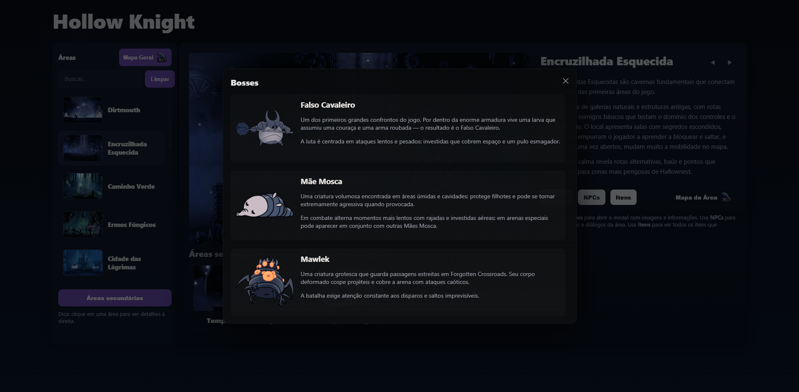
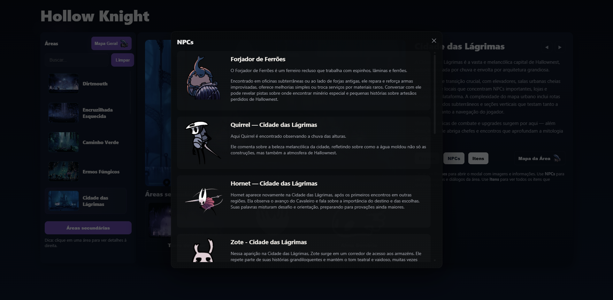
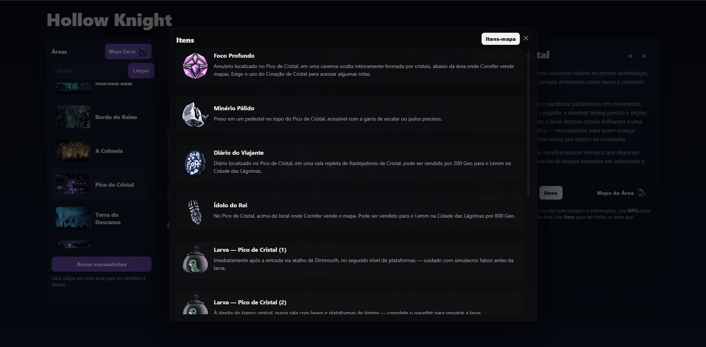
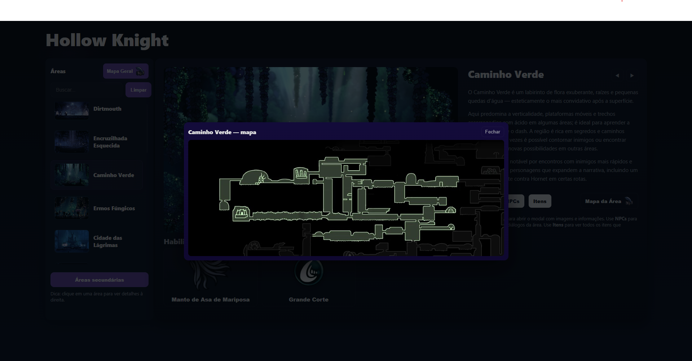
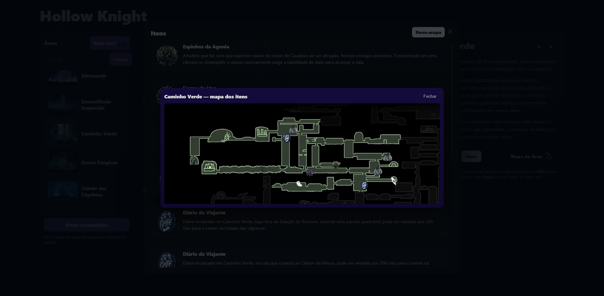

<div align="center">


# HOLLOW KNIGHT
### ✦ GUIA INTERATIVO ✦

*Explore Hallownest. Descubra seus segredos.*

<br />

<a href="https://soldesi.github.io/Hollow-Knight-Guia/">
  
</a>

<br /><br />



<br />

<sub>Um guia para aventureiros que desejam desvendar cada canto de Hallownest.</sub>

<br /><br />

</div>

---

## ✦ Sobre

Descubra as regiões, enfrente criaturas lendárias e conheça os personagens que habitam o mundo de **Hollow Knight**. Tudo reunido em um guia interativo, com mapas e informações para acompanhar a sua jornada.

---

##  Prints

<div>

###  Chefes



<br />

###  NPCs



<br />

###  Itens



<br />

###  Mapas



<br />

###  Itens no mapa



</div>

---

## 🛠️ Tecnologias

- **React** + **TypeScript** — interface e tipagem
- **Vite** — build e servidor de desenvolvimento
- **GitHub Pages** — hospedagem

---

## 🚀 Rodar localmente

```bash
# clonar o repositório
git clone https://github.com/Soldesi/Hollow-Knight-Guia.git
cd Hollow-Knight-Guia

# instalar dependências
npm install

# iniciar o servidor de desenvolvimento
npm run dev
```

Para gerar a versão de produção:

```bash
npm run build
```

---

<div align="center">

**Desenvolvido por [Soldesi](https://github.com/Soldesi)**

<sub>Projeto independente de fã, sem vínculo oficial com a Team Cherry.</sub>
<br />
<sub>Hollow Knight e Hollow Knight: Silksong são propriedades de seus respectivos titulares.</sub>

<br />

⭐ **Gostou do projeto? Deixe uma estrela no repositório!**

</div>
